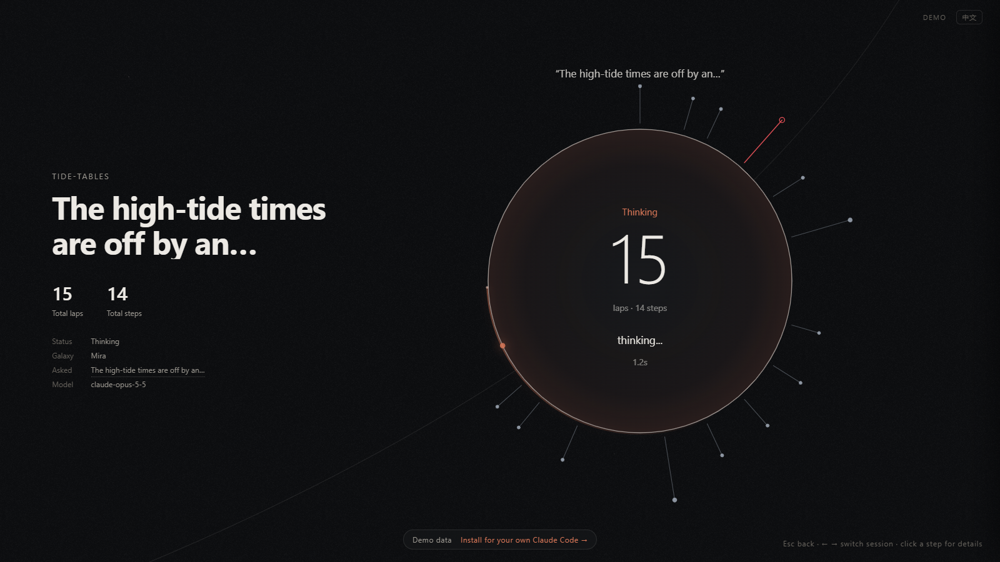

<p align="center"></p>

<h1 align="center">Agent Loop</h1>

<p align="center">See what your coding agent is actually doing.<br>
Every Claude Code session becomes a planet; every tool call is a ray, as long as it took.</p>

<p align="center"><a href="https://sacryu.github.io/agent-loop-viz/"><b>Live demo</b></a> · <a href="README.zh-CN.md">中文</a> · <a href="docs/privacy.md">Privacy</a> · <a href="docs/physics.md">The physics behind it</a></p>

<p align="center"></p>

Agent Loop is a plugin plus a small server that draws your Claude Code sessions as they run:

- **Galaxy group**: you, or you and your friends. Each person is a galaxy; the brighter it is, the more sessions are working.
- **Planetary system**: click a galaxy. The star in the middle is the model (a red dwarf for Haiku, a Sun-like star for Sonnet, a blue giant for Opus). Each orbit is a project, each planet a session, each ray a step.
- **Dial**: click a planet. Steps fan out clockwise from 12 o'clock: `Run npm test`, `Edit app.ts`, `Read cart.ts`. Coral is the step running right now, red is an error, white ripples mean it's waiting for your approval.
- **Step details**: click a step to see its full input and output.

Every visual has a real physical basis (limb darkening, differential rotation, Kepler's third law, flat rotation curves in dark-matter halos…), see [docs/physics.md](docs/physics.md).

## Quick start (just you, on your computer)

Needs Node.js 20+ (`npx agent-loop-viz` runs the server; the plugin alone needs 18+).

```sh
npx agent-loop-viz          # starts the server at http://127.0.0.1:4317
```

In Claude Code:

```
/plugin marketplace add sacryu/agent-loop-plugin
/plugin install agent-loop@agent-loop
/reload-plugins
```

Open http://127.0.0.1:4317 and start working. Nothing to configure: the plugin reports to `127.0.0.1` by default, and data never leaves your computer. `/galaxy` prints the address of your own galaxy.

## With friends: galaxy groups

A galaxy group is a few galaxies that can see each other. It lives on a server: your own, or a hosted one. The **invite link** (`https://<server>/#k=<key>`) carries the group's key:

- The plugin encrypts everything except anonymous categories and timings with that key (AES-256-GCM) before sending it.
- The browser decrypts it. The part after `#` is never sent to the server, so **the server only ever sees anonymous categories, timings, and ciphertext it can't read.**
- Anyone with the link can watch the group and connect their own galaxy. Only send it to people you trust.

Which group your galaxy is in is managed only in Claude Code, by the plugin; the web page just shows what you're in.

**Create a group**: run `/agent-loop:create https://<server>` in Claude Code (without the address it uses the server you report to now). The plugin checks that the server takes new groups, generates the key on your computer and reports your galaxy to the new group; only once the server accepts it does it save the new invite link into its `server_url` setting (if the server refuses, your current setting is left alone). Both the plugin and the server need to be 0.2.11 or newer. The key never shows up in the conversation: the group opens in your browser with the invite link ready to copy (later it's under **Invite**). Run `/reload-plugins` afterwards. Servers that only accept listed groups (`GROUPS`) need the admin to make the link with `npx agent-loop-viz invite`.

**Check where you report**: `/agent-loop:status` shows the server and group fingerprint, whether the plugin is reporting, the last result, your galaxy's name and sharing level, and the plugin version.

**Invite someone**: on the page, open **Invite** (top right). **Copy link** copies the link to watch the group; **Copy for Claude Code** copies a short prompt for them to send to their own Claude Code. It runs four commands: add and refresh the plugin marketplace, install the plugin with the invite link, then `report.mjs --welcome` from the plugin. That last one puts the session they're in on the map right away (no need to wait for `/reload-plugins`), opens their own galaxy in the browser with a "This is your galaxy" card, and hands Claude a note on what Agent Loop is and what it sends (permissions and encryption), with the question whether to change `name` and `share`. They still need to run `/reload-plugins` (Claude can't) before that session's steps are drawn; new sessions report on their own. Someone who opens the link first gets the same prompt on the page.

**Join a group by hand**: run these in a terminal (also when the plugin is already installed: it switches to the new group), then `/reload-plugins` in Claude Code. The first time you say something in the group, the plugin has Claude give the same note:

```sh
claude plugin marketplace add sacryu/agent-loop-plugin
claude plugin install agent-loop@agent-loop --config "server_url=<invite link>"
```

Typed into your own terminal, that leaves the key in your shell history. To avoid that, install without `--config`, then in Claude Code run `/plugin configure agent-loop@agent-loop`, paste the link into **Server URL or invite link** (the input is masked) and choose **Save**. `claude plugin configure` in a terminal only lists the options.

**Leave a group**: run `/agent-loop:leave` in Claude Code. Every session on this computer stops reporting to the group right away (no reload), and the server removes your galaxy and the step details it holds for you. Your settings still hold the invite link: set **Server URL or invite link** back to `http://127.0.0.1:4317` to watch on this computer again, or run `/agent-loop:rejoin` to go back. The group's page then opens in your browser: it clears the group's key from that browser and shows that you left (needs a 0.2.12 or newer server). To stop *watching* a group in a browser, use **Clear cache** under **Invite** on the page; that only makes the browser forget the key, and your galaxy keeps reporting until you run `/agent-loop:leave`. After leaving, `/agent-loop:galaxy` says so instead of opening the old group.

The plugin needs Node.js 18+ (`node` on your PATH). If it can't report (no key in the link, the link is missing `http://`/`https://`, server unreachable or refusing, Node too old), Claude Code shows a one-line warning when a session starts.

**Host a group on your own server** (needs Docker, a domain pointing at the server, ports 80/443):

```sh
npx agent-loop-viz invite https://loop.example.com   # prints the invite link and a group id
cp deploy/.env.example deploy/.env               # set DOMAIN and GROUPS=<that group id>
docker compose -f deploy/compose.yml up -d --build
```

Send the invite link to your friends. The key is generated on your computer and never touches the server. See [docs/deploy.md](docs/deploy.md).

## How much is shared

You choose, in the plugin's `share` setting:

| `share` | What leaves your computer |
|---|---|
| `anonymous` | Event categories and timings only: when you work, how many sessions, which *kind* of tool each step used, how long it took |
| `summary` | Plus: your galaxy name, project folder name, session title, each step's tool and target (file name, start of the command, search pattern), first line of errors, last sentence of each answer |
| `full` | Plus: your complete prompts, tool input and output, full answers and errors |
| `auto` (default) | `full` on your own computer, `summary` everywhere else |

Away from your own computer, attachments are always encrypted, and with no invite link nothing is sent at all. The single script that sends anything is [`plugin/hooks/report.mjs`](plugin/hooks/report.mjs): no dependencies, no build step, readable in one sitting. Details, including what a server can still see, in [docs/privacy.md](docs/privacy.md).

## Plugin settings

| Setting | Default | |
|---|---|---|
| `server_url` | `http://127.0.0.1:4317` | Your local server, or an invite link. Stored as a sensitive setting (secure storage, not `settings.json`) |
| `share` | `auto` | See above |
| `name` | empty | Your galaxy's name in a group; empty means an auto-generated catalog number like `ALC 1342+27` |

Change them with `/plugin configure agent-loop@agent-loop` in Claude Code, or from a terminal by piping just the keys you want to change: `echo '{"name":"Alex","share":"summary"}' | claude plugin configure agent-loop@agent-loop --values-stdin`. Then `/reload-plugins`.

## Using the page

- Group: drag to pan, scroll to zoom, click a galaxy to fly in. **Invite** (top right) copies the link, or the prompt your friends send to their Claude Code to connect.
- Planetary system: hover a planet for its card, drag to spin, scroll to fly closer (scrolling on a planet follows it); once zoomed in, drag pans instead of spinning (zoom back out to spin). Click a planet to open its dial. Esc goes back, ← → switches sessions.
- Dial: hover a step to see it; click for full details.
- `?lang=en` / `?lang=zh` switches the language (it follows the browser by default).
- `?demo` plays the built-in demo; `?demo&n=2000` is a 2000-galaxy stress test.

## Development

```sh
npm install
npm run check            # type check (including report.mjs's JSDoc) + all tests
npm run build            # web/dist and server/dist/server.mjs
npm start                # local server
node tools/simulate.mjs --galaxies 3 --sessions 4      # fake sessions through the real plugin code
npm run build:demo       # the static demo site (web/dist-demo)
```

```
plugin/        the Claude Code plugin: manifest, hooks.json, report.mjs, /agent-loop:galaxy, status, create, leave, rejoin
shared/        protocol schema, attachment slots, wire format, and the state machine (used by server and demo)
server/        receive, validate, rate-limit, group isolation, push to browsers
web/           the page (TypeScript + Vite, Canvas 2D / WebGL); crypto.ts decrypts in the browser
cli/           the npm package: npx agent-loop-viz, npx agent-loop-viz invite
tools/demo/    the demo site's script (all fictional) and its expander
docs/          plan, privacy, physics, findings
```

## Known limitations

- Claude Code only for now.
- Pressing Esc while the model is thinking sends no event; the session shows "thinking" for up to two minutes before going idle.
- The server keeps everything in memory. Lap and step counts still cover the whole conversation after a server restart: the plugin counts them from the local transcript and sends just the two numbers.
- No kicking members or rotating keys yet: anyone can leave (`/agent-loop:leave`), but to revoke an invite link, create a new group.
- The page's code comes from the server you open. A malicious host could serve a page that steals the key; use your own server if that matters to you.

Agent Loop is an independent project. It is not made by, endorsed by, or affiliated with Anthropic.

## License

[MIT](LICENSE)
